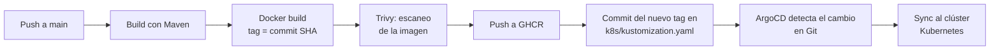

# PruebaDevSecOps

# Spring Boot Microservice: CI/CD con GitHub Actions y GitOps con ArgoCD

Microservicio Spring Boot con un pipeline DevSecOps completo: compilación, imagen Docker, escaneo de seguridad, publicación en un container registry y despliegue continuo mediante GitOps con ArgoCD sobre Kubernetes.

## Flujo del pipeline



1. Un `push` a `main` dispara el workflow.
2. Maven compila el proyecto (JDK 17) y se construye la imagen Docker, etiquetada con el SHA del commit y con `latest`.
3. Trivy escanea la imagen. Si encuentra vulnerabilidades HIGH o CRITICAL con corrección disponible, el pipeline se detiene antes de publicar.
4. La imagen se publica en GitHub Container Registry (GHCR).
5. El pipeline actualiza `newTag` en `k8s/kustomization.yaml` con el SHA del commit y hace commit de vuelta a `main`.
6. ArgoCD detecta el cambio en el repositorio y sincroniza el clúster con el nuevo tag.

## Tecnologías

| Componente | Herramienta |
|---|---|
| Aplicación | Spring Boot (Java 17, Maven) |
| CI | GitHub Actions |
| Registry | GitHub Container Registry (GHCR) |
| Seguridad | Trivy (imagen y configuración) |
| Manifiestos | Kustomize |
| CD / GitOps | ArgoCD |
| Orquestación | Kubernetes (Docker Desktop) |
| Observabilidad | Prometheus y Grafana (`argocd/monitoring.yaml`, `k8s/servicemonitor.yaml`) |

## Estructura del repositorio

```text
.
├── .github/workflows/deploy.yaml   # Pipeline de CI y actualización del tag (GitOps)
├── application.yaml                # Application de ArgoCD que gestiona el microservicio
├── argocd/                         # Recursos de ArgoCD (monitoreo)
├── k8s/
│   ├── deployment.yaml
│   ├── service.yaml
│   ├── servicemonitor.yaml
│   └── kustomization.yaml          # Referencia de la imagen (equivale al values.yaml)
├── infra/                          # Infraestructura
├── src/                            # Código fuente
├── Dockerfile
└── pom.xml
```

## Entregables de la prueba

| Entregable | Archivo |
|---|---|
| Workflow de GitHub Actions | [`.github/workflows/deploy.yaml`](.github/workflows/deploy.yaml) |
| Referencia de la imagen (equivalente a `values.yaml`) | [`k8s/kustomization.yaml`](k8s/kustomization.yaml) |
| Manifiesto Application de ArgoCD | [`application.yaml`](application.yaml) |

### Referencia de la imagen

Se usa Kustomize en lugar de Helm. La sección `images` de `k8s/kustomization.yaml` cumple el rol del `values.yaml`: es el archivo que el pipeline actualiza en cada ejecución con el SHA del commit.

```yaml
apiVersion: kustomize.config.k8s.io/v1beta1
kind: Kustomization
resources:
  - deployment.yaml
  - service.yaml
  - servicemonitor.yaml
images:
  - name: ghcr.io/oscargt85/springboot-microservice
    newTag: "<commit-sha>"   # lo reemplaza el pipeline
```

### Application de ArgoCD

```yaml
apiVersion: argoproj.io/v1alpha1
kind: Application
metadata:
  name: springboot-microservice
  namespace: argocd
spec:
  project: default
  source:
    repoURL: https://github.com/Oscargt85/PruebaDevSecOps.git
    targetRevision: main
    path: k8s
  destination:
    server: https://kubernetes.default.svc
    namespace: springboot
  syncPolicy:
    automated:
      prune: true
      selfHeal: true
    syncOptions:
      - CreateNamespace=true
```

## Decisiones de diseño

- **GHCR en lugar de DockerHub o Quay.** Está integrado con GitHub y el workflow se autentica con `GITHUB_TOKEN`, sin guardar credenciales adicionales.
- **Kustomize en lugar de Helm.** La aplicación es un único microservicio y Kustomize permite cambiar el tag de la imagen sin plantillas.
- **Tag con el SHA del commit.** Cada despliegue es trazable e inmutable. El tag `latest` se publica solo por conveniencia; el clúster siempre usa el SHA.
- **Sin bucles de ejecución.** El commit del bot incluye `[skip ci]` y el workflow ignora los cambios en `k8s/**` (`paths-ignore`), por lo que su propio commit no vuelve a disparar el pipeline.
- **Reintentos al actualizar el tag.** El paso de GitOps hace hasta 3 intentos con `fetch` y `reset` antes de empujar, para tolerar pushes concurrentes.
- **Escaneo de seguridad integrado.** Trivy bloquea la publicación si la imagen tiene vulnerabilidades HIGH o CRITICAL con corrección disponible. El escaneo de Dockerfile y manifiestos solo informa, no bloquea.
- **Un solo pipeline concurrente.** El grupo `build-main` evita que dos ejecuciones compitan por actualizar el mismo archivo.

## Cómo reproducirlo

### Requisitos

- Clúster de Kubernetes (por ejemplo, Docker Desktop con Kubernetes activado).
- ArgoCD instalado en el namespace `argocd`.
- Paquete de GHCR público, o un `imagePullSecret` en el namespace `springboot` si es privado.

### Pasos

1. Haz un fork o clona el repositorio y ajusta `IMAGE_NAME` en el workflow y `repoURL` en `application.yaml`.
2. Registra la aplicación en ArgoCD (una sola vez):

   ```bash
   kubectl apply -f application.yaml
   ```

3. Haz un cambio en el código y súbelo a `main`:

   ```bash
   git pull --rebase origin main
   git push origin main
   ```

4. Verifica el resultado:

   ```bash
   kubectl get applications -n argocd
   kubectl get pods -n springboot
   kubectl get deployment -n springboot \
     -o jsonpath="{.items[*].spec.template.spec.containers[*].image}"
   ```

   La imagen debe terminar en el SHA del último commit de despliegue.

### Acceso a la UI de ArgoCD

```bash
kubectl port-forward svc/argocd-server -n argocd 8080:443
```

Abre `https://localhost:8080` con el usuario `admin`. La contraseña inicial está en el secret `argocd-initial-admin-secret`.

> El bot escribe en `main` después de cada despliegue. Haz `git pull --rebase origin main` antes de cada push para evitar rechazos por historial desactualizado.

## Evidencias

> Reemplaza cada marcador con tu captura (carpeta `docs/img/`, por ejemplo).

1. **GitHub Actions** con la ejecución en verde.
   ``
2. **Commit del bot** `deploy: <sha> [skip ci]` modificando `k8s/kustomization.yaml`.
   ``
3. **ArgoCD** con la aplicación en estado Synced y Healthy.
   ``
4. **Deployment en el clúster** corriendo con la imagen etiquetada con el SHA.
   ``